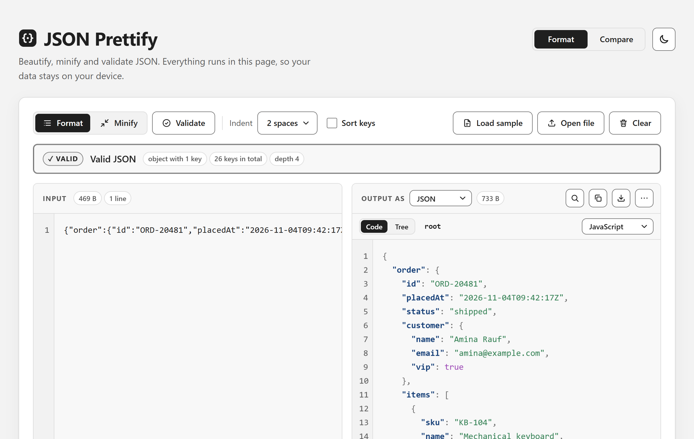
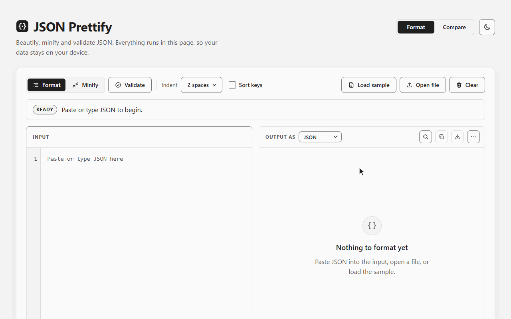

<p align="center">
  
</p>

<h1 align="center">JSON Prettify</h1>

<p align="center">
  Format, validate, explore and compare JSON in your browser. Works offline, and nothing is uploaded.
</p>

<p align="center">
  <a href="https://xitas.github.io/json-prettify/"><strong>Try it live</strong></a>
  ·
  <a href="https://github.com/xitas/json-prettify/actions/workflows/test.yml"></a>
  <a href="LICENSE"></a>
</p>

<picture>
  <source media="(prefers-color-scheme: dark)" srcset="docs/screenshot-dark.png">
  
</picture>

Plain HTML, CSS and JavaScript: no frameworks, no build step and no requests to other sites. It even works when you open `index.html` straight from disk.

<p align="center">
  
</p>

## Features

**Formatting and fixing**
- Format with 2 spaces, 4 spaces or tabs, or minify (with the size saved); sort keys alphabetically
- Validation as you type, with a plain-English message, the line and column, and a jump to the error
- **Fix JSON** repairs almost-JSON: trailing and missing commas, single or curly quotes, unquoted keys, comments, `True` / `None` / `undefined` / `NaN` and a stray byte order mark. Text inside strings is never changed, and `Ctrl/Cmd + Z` undoes it

**Tree view and paths**
- Fold and unfold objects and arrays, open to a level, and move around with the keyboard; big arrays show 100 items at a time
- Click a key (or press `C`) to copy its path as JavaScript, JSONPath, jq or JSON Pointer; `Shift + C` copies the value

**Search**
- Search keys, values or both, with match case, whole word and regex, a match count, next and previous, and a Filter that keeps only matching branches

**Output formats**
- JSON, YAML (quoting anything a parser could misread), CSV for arrays of objects (nested keys as `dotted.columns`, formula-injection protection, Excel-friendly downloads) and TypeScript interfaces or types inferred from the data

**Compare**
- Compares the data, not the text, so whitespace and key order don't count. Every addition, removal and change is listed with its path, side by side with the changes marked
- Arrays matched by position, smartly or by a key such as `id`; copy the changes as a JSON Patch (RFC 6902) or as text

**JSON Schema**
- Validation against draft 2020-12 and draft-07, with each error's path, message and keyword; click one to jump to the value
- Generate a schema from your JSON

**Sharing**
- Share links carry the JSON (or both sides of a comparison) inside the link itself, compressed. See [Privacy](#privacy)
- Copy, download as a file, or open a file from your device

**Large files**
- Tested up to 50 MB: the work runs in a Web Worker so the page never freezes, only the lines on screen are drawn, and long jobs show progress with a Cancel button

**Offline and install**
- Works offline after the first visit, can be installed as an app, and opens `.json` files from your computer in Chrome and Edge. See [Install and offline use](#install-and-offline-use)

Light and dark themes, keyboard support throughout, and reduced motion are all built in.

## Keyboard shortcuts

| Keys | What it does |
| --- | --- |
| `Ctrl/Cmd + Enter` | Format the input |
| `Ctrl/Cmd + Shift + Enter` | Fix broken JSON |
| `Ctrl/Cmd + S` | Download the result |
| `Ctrl/Cmd + F` (in the output) or `/` | Search |
| `Enter` / `Shift + Enter` | Next / previous match |
| `Esc` | Close the search or a menu |
| `C` / `Shift + C` (in the tree) | Copy the path / the value |
| `Alt + ↓` / `Alt + ↑` (Compare) | Next / previous change |

## Privacy

Everything runs in your browser. Your JSON is never uploaded, logged or sent anywhere, and the page loads nothing from other sites.

- **Share links** hold the JSON itself, compressed, in the part of the address after `#`. Browsers never send that part to a server, so not even GitHub Pages sees it. Anyone who has the link can read the JSON, so share it as you would the data.
- **Saved in your browser:** your settings (theme, indent, output format and so on). A JSON Schema is kept only if you turn that on.
- **Offline copy:** the service worker stores the app's own files, never your data.

## Browser support

Current versions of Chrome, Edge, Firefox and Safari, on desktop and mobile. Installing as an app depends on the browser: Chrome and Edge (desktop and Android) offer **Install app**, and Safari on iPhone and iPad uses **Add to Home Screen**. Opening `.json` files with the installed app works in Chrome and Edge on desktop.

## Install and offline use

JSON Prettify can be installed as an app, and works offline after your first visit.

- **Install:** in Chrome or Edge on a computer or Android, open the **⋯** menu above the output and choose **Install app** (it only shows when the browser can install it, and not once it is installed). On iPhone and iPad, tap **Share**, then **Add to Home Screen**.
- **Open `.json` files with it:** once installed in Chrome or Edge on a computer, choose JSON Prettify in your system's "Open with" menu for a `.json` file.
- **Offline:** a service worker keeps the app's own files (never your JSON), so everything works without a connection: formatting, Tree, search, every output format, Compare, Schema, Share links and Download.
- **Updates:** when a new version is published, a bar says "A new version is available." Click **Reload** to switch (what you typed is kept), or close the bar to get it next time. The page never reloads by itself.
- **Remove the app:** in the app window, open its menu (**⋯** in the title bar) and choose **Uninstall**, or go to `chrome://apps` / `edge://apps`. On iPhone and iPad, press and hold the icon and choose **Remove App**.
- **Clear the offline copy:** on the site, open the site settings (the icon left of the address) and choose **Delete data** or **Clear site data**, or in DevTools go to **Application → Storage → Clear site data**.

The service worker only runs over https (GitHub Pages) or on `localhost`. Opened straight from disk, the page works as before, just without offline caching or installing.

## Development

No build step: open `index.html`, or serve the folder (for example `python3 -m http.server 8000`) to try the service worker on `localhost`.

The tests use Node's built-in test runner and need Node.js 22 or newer. Two dev dependencies (`yaml`, `typescript`) check the converters against real parsers; the page itself never loads anything from npm.

```bash
npm ci
npm test
```

| Script | What it does |
| --- | --- |
| `npm test` | Runs every unit test (`node --test`), as GitHub Actions does on each push and pull request |
| `npm run build-sw` | Writes the list of app files and their content hashes into `sw.js` |
| `npm run schema-suite` | Downloads the official JSON Schema Test Suite to `test-data/schema-suite/` (not committed); without it those tests are skipped |
| `npm run large-files` | Writes big test files (1 to 50 MB) to `test-data/large/` (not committed); pass sizes in MB to choose others |
| `npm run icons` | Remakes the app icons from the logo (needs Chrome or Edge) |
| `npm run og-image` | Remakes `og-image.png`, the link preview image |
| `npm run readme-media` | Remakes the screenshots and the demo GIF in `docs/` |

> **After changing any app file** (the page, styles, scripts, icons or manifest), run `npm run build-sw`. The new hashes make a new cache version, so visitors get the change. `tests/sw.test.js` fails if you forget.

Known bugs are recorded as tests marked `todo`, which show up as `TODO` without failing the run. There are none at the moment.

## Project structure

```
.
├── index.html              Page markup, link-preview tags and structured data
├── manifest.webmanifest    App name, icons and .json file handler
├── sw.js                   Service worker (offline copy, update prompt)
├── og-image.png            Link preview image
├── robots.txt, sitemap.xml
├── assets/
│   ├── css/style.css       Styles and the light and dark theme colors
│   ├── icons/              App icons
│   └── js/
│       ├── json-tools.js   Pure logic: parsing, errors, repair, conversions, search, diff, schema
│       ├── app.js          The page: toolbar, input and output, Tree view, worker, sharing, install
│       ├── code-view.js    Code view that draws only the lines on screen
│       ├── doc-input.js    The JSON input box used by Compare and the Schema panel
│       ├── compare.js      Compare mode
│       └── schema.js       The JSON Schema panel
├── docs/                   README screenshots and demo
├── scripts/                Dev scripts (see the table above); lib/ holds shared helpers
└── tests/                  Unit tests
```

## Contributing

Issues and pull requests are welcome. Please keep to the project's style:

- Plain HTML, CSS and JavaScript, with no runtime dependencies or requests to other sites, and it must keep working from `file://`.
- Logic without the DOM goes in `json-tools.js`, with unit tests.
- Check light and dark mode, a 390 px wide phone screen, keyboard use and reduced motion.
- Run `npm test` and `npm run build-sw` before you commit.

## License

[MIT](LICENSE) © 2026 xitas
